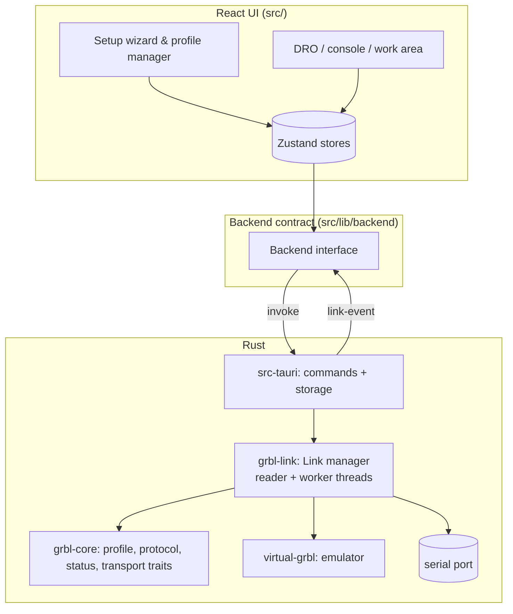

# CNC Sender

A modern G-code sender, visualizer and machine simulator for GRBL-based CNC routers, lasers and rotary
machines. Desktop app for Windows, macOS and Linux (Tauri 2 + React + Rust).

> **Status: Phase 4 of 8.** Adds a 3D toolpath viewer (colour by move type, feed, depth or power; live
> progress; playback scrubber 0.1–100×; top/front/side/3D views, fit, follow; rulers; measuring tool).
> Phase 3 added a full G-code interpreter, a GRBL planner model for time estimates, job
> statistics, a G-code editor with hover docs and error markers, drag-and-drop / recent files / history, and
> a travel check in pre-flight. From Phase 2: Machine profiles and setup wizard, a built-in virtual GRBL controller, job
> streaming (character counting) with pause/resume/stop and check mode, pre-flight checks, jogging,
> homing, zeroing, work offsets, overrides, and a `$$` settings editor that compares the controller with
> your profile. The G-code engine (accurate time estimates, bounds checks), 3D view and simulation come
> next. Treat it as beta: test on air or scrap before trusting it with real work.

**Safety:** the on-screen STOP is a software feed-hold + reset. It is **not** an emergency stop. Always keep a
hardware E-stop within reach.

For end users: see the [User Guide](docs/USER_GUIDE.md).

## Setup (developers)

Prerequisites:

| | Windows | macOS | Linux (Debian/Ubuntu) |
|---|---|---|---|
| Node.js 20+ | `winget install OpenJS.NodeJS.LTS` | `brew install node` | distro or nvm |
| Rust (stable) | `winget install Rustlang.Rustup` | `curl https://sh.rustup.rs -sSf \| sh` | same |
| Native toolchain | VS 2022 Build Tools, "Desktop development with C++" | Xcode Command Line Tools | `sudo apt install libwebkit2gtk-4.1-dev build-essential libssl-dev libayatana-appindicator3-dev librsvg2-dev libudev-dev` |
| WebView | WebView2 (preinstalled on Windows 10/11) | built in | webkit2gtk (above) |

Linux serial access: add yourself to the `dialout` group (`sudo usermod -aG dialout $USER`, then log out/in).

```bash
npm install
```

```bash
npm run app
```

`npm run app` builds the Rust side and opens the desktop app with hot reload. To work on the UI without
Rust, run `npm run dev` and open http://localhost:1420 (a browser preview with a stub backend).

### Tests

```bash
npm test
```

```bash
npm run test:e2e
```

```bash
cargo test --workspace
```

```bash
cargo clippy --workspace --all-targets -- -D warnings
```

### Release build

```bash
npm run tauri build
```

Signed installers and auto-update are Phase 8.

## Architecture



- **Profile manager** — `src/lib/profile/*` + `src/store/profiles.ts`. Zod schema is the source of truth;
  `crates/grbl-core/src/profile.rs` mirrors it for validation and to configure the emulator.
- **Transport** — `grbl_core::transport::{ByteReader, ByteWriter, TransportFactory}`; implementations in
  `grbl-link/src/serial.rs` and `virtual-grbl/src/port.rs`.
- **Protocol** — `grbl-core/src/protocol.rs` (every GRBL line type), `status.rs` (status reports incl.
  GRBL 0.9 format), `firmware.rs`.
- **3D viewer** — `src/features/viewer/`: react-three-fiber scene; one shader-coloured `LineSegments` draw
  call built in the worker (`src/lib/gcode/render.ts`), playback state in `src/store/sim.ts`.
- **G-code engine** — `src/lib/gcode/`: modal interpreter → typed-array toolpath → planner (time) → stats,
  in a Web Worker. Cross-checked against the emulator (`scripts/gen-timing-fixtures.mjs`).
- **Streaming engine** — `grbl-link/src/sender.rs`: character counting / send-response, job state machine,
  continuous-jog chunks. Pure logic, unit tested.
- **Connection manager** — `grbl-link/src/link.rs`: threads, acks, job stop sequence, controller info
  (`$$ $# $G $I`), real-time bytes, reconnect.
- **Virtual GRBL** — `virtual-grbl/src/machine.rs`: deterministic emulator used by tests and by the app's
  "Virtual machine" port.
- **Future modules** (interpreter, planner, simulator, streamer) have their interfaces in
  `src/core/interfaces.ts`.

More detail, conventions and decisions: [AGENTS.md](AGENTS.md).

## How to add a feature

1. Decide which module owns it (see `src/core/interfaces.ts`). Timing-critical or protocol logic goes in
   Rust (`crates/`), UI and file-level logic in TypeScript.
2. Anything machine-specific must come from the active profile — add a profile field if needed (below).
3. Add tests next to the code (Vitest `*.test.ts`, Rust `#[cfg(test)]`, or `crates/grbl-link/tests/` for
   anything that talks to a controller — run it against `virtual-grbl`).
4. If you change the IPC contract, update `src/lib/backend/types.ts` and the contract test in `grbl-link`.

### Adding a profile field

1. Add it to `MachineProfileSchema` in `src/lib/profile/schema.ts`.
2. Add a `FieldMeta` entry in `src/lib/profile/fields.ts` (label, hobbyist-friendly help, unit). A test
   fails if you forget.
3. Mirror it in `crates/grbl-core/src/profile.rs`.
4. Add it to every file in `presets/`.
5. If existing saved profiles lack it: bump `SCHEMA_VERSION` and add a migration in `migrate.ts` with a test.

## How to add a machine preset

1. Copy `presets/generic-router.json` to `presets/<your-id>.json`.
2. Set `"id": "preset-<your-id>"`, `identity.presetId: "<your-id>"`, a clear name and notes that say where
   the values came from.
3. Fill in values from the machine's `$$` output (`$100–$102` steps, `$110–$112` rates, `$120–$122` accel,
   `$130–$132` travel, `$22–$27` homing, `$30–$32` spindle/laser).
4. Add `{ id, blurb }` to `ORDER` in `src/lib/profile/presets.ts` and the id to `PRESETS` in the Rust test in
   `crates/grbl-core/src/profile.rs`.
5. Run `npm test` and `cargo test --workspace` — both parse every preset and the link tests connect the
   emulator configured from it.

## Samples

`samples/gcode/` has test programs (square, arcs in all planes, pocket with a G20/G21 switch, laser vector and
raster, A-axis rotary, 3D contour). `node scripts/gen-stress.mjs` writes a multi-million-line stress file.
`samples/profiles/` has shareable profile files you can import.
